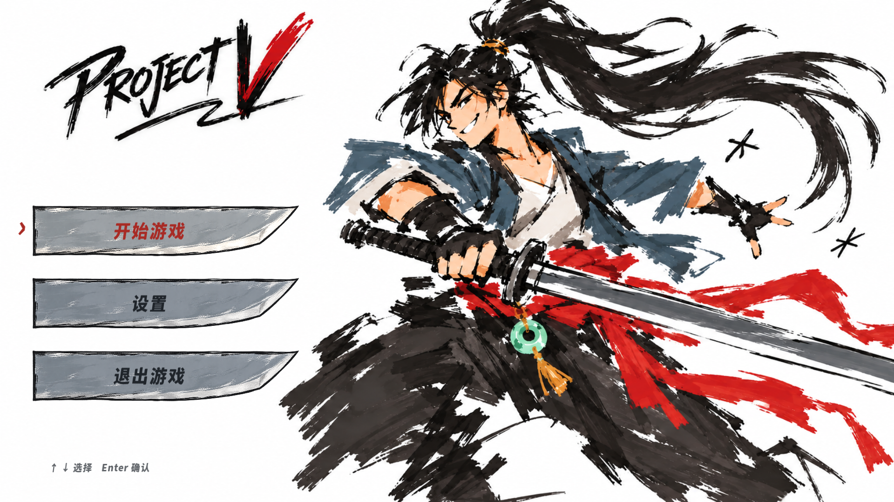
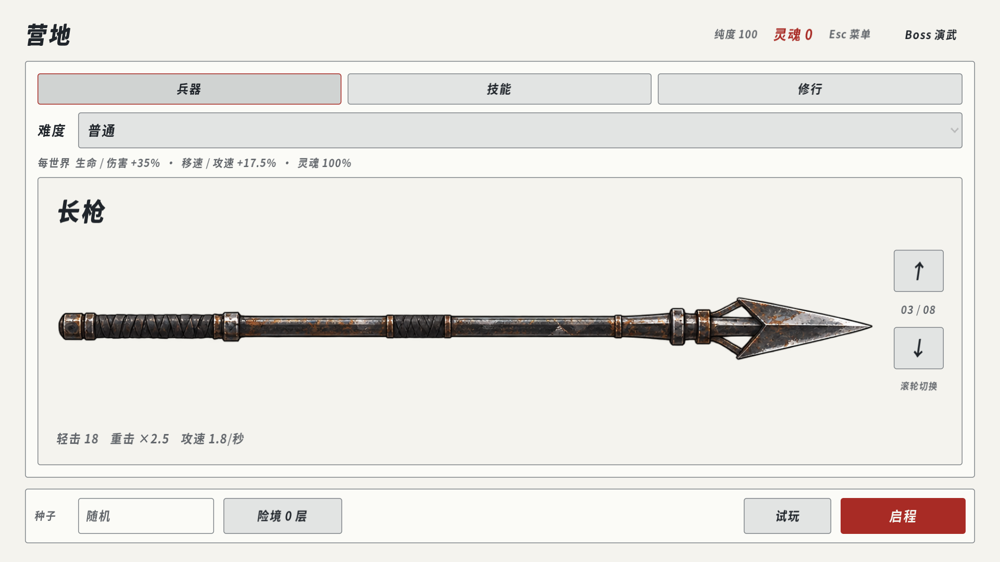
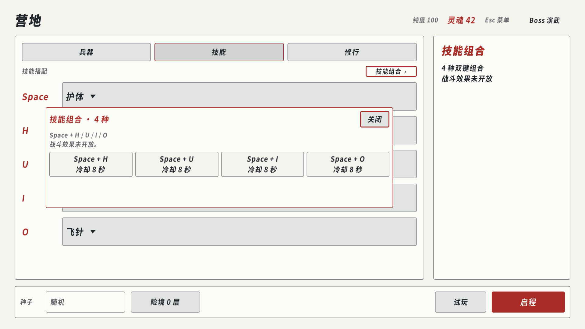
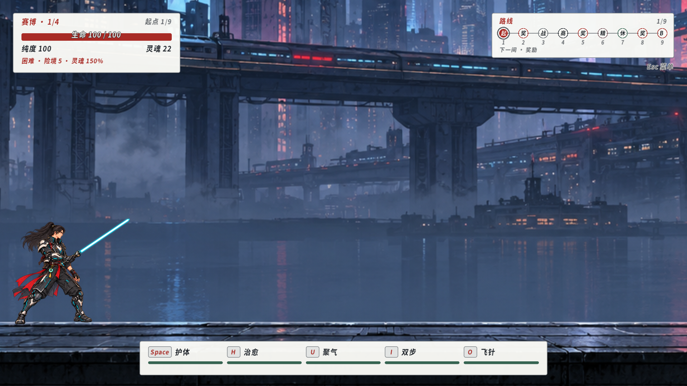

11月2日至6日，PROJECT-V 从三世界流程扩展到四界随机行旅，同时整理了首页、营地配装、Boss 技能与战斗信息。当前主线仍使用 Godot 4.7.2 Mono、.NET 8 和 C# 12。

这轮交互调整的重点很具体：选武器时看清当前这一把，搭配技能时只处理技能，进入下一世界时让流程自动继续。

<!-- more -->

## 从首页进入独立配装页面

涂鸦首页使用米白留白、炭灰人物与朱红强调，左侧三枚刀刃分别承载开始、设置和退出。游戏文字采用已落地的“断锋刀刻”正文与标题字体。四页漫画开场经过颗粒清理，以10秒交叉淡入播放，Space 或 Esc 可跳过；营地移除了回看入口。

营地现在分为兵器、技能、修行三页。兵器页只展示一把大图，名称、伤害、攻速与序号放在同一个框中；右侧上下按钮和框内滚轮循环切换八件兵器。切换立即改变选装，框外滚动不会误换武器。

五个技能槽移到独立页面，详情按当前项目显示。换页保留搭配，重复装入同一技能仍会被阻止。HUD、商店、奖励与结算同步采用首页色调；价格、效果和纯度代价分层，闲置提示隐藏。

## 复合输入只保留四组

复合按键限定为 **Space+H、Space+U、Space+I、Space+O**。先后顺序不影响识别，每组仍使用独立8秒冷却；组合触发或因冷却被拒绝后，需要全部松键才能开始下一轮。具体复合战斗效果尚未开放。

删掉另外六组时，不能只改界面列表。旧输入解析会把第二个键一起消费，因此无匹配分支也要调整：H、U、I、O 彼此重叠时，不触发组合，各自松开仍尝试施放原基础技能。多个键按住后补按 Space，则与最早仍按住的键配对。

组合目录、输入识别与战斗候选都读取同一份定义，避免出现“列表删了，实战仍能触发”的差异。单测覆盖12个有序非 Space 按键对的两种释放顺序，共24例；运行场景还检查实际基础技能、暂停和换房后的输入清理。

## 四个世界构成完整一局

废土、赛博、生化与手绘世界现在每局各出现一次，顺序由种子洗牌。前三个世界挑战完成后自动结算并继续，保留同一局的强化、纯度与挑战设置。最终通关、死亡以及第四世界末尾的镜像选择仍有各自的流程。

主角外观随世界变化；手绘世界沿用完整人物动作，使用蓝灰衣装配色。真正的飞行敌人只走空中生成与悬停逻辑。商店取消自动购买最便宜物品，玩家通过点击或数字键选购，离开商店不会触发购买。当前版本停用音频，音轨制作留待后续。

难度在启程前固定。每进入下一个世界，生命和伤害在上一世界基础上复利增长，移速与攻击冷却恢复速度使用一半增幅。

| 难度 | 生命与伤害增长 | 移速与冷却恢复增长 | 灵魂收益 |
| --- | --- | --- | --- |
| 简单 | 20% | 10% | 80% |
| 普通（默认） | 35% | 17.5% | 100% |
| 困难 | 60% | 30% | 120% |
| 噩梦 | 90% | 45% | 150% |

险境取消原10层玩法上限：生命每层增加15%，攻击冷却恢复速度每层增加10%。灵魂收益再乘以 `1 + 总险境层数 × 5%`，小数余数在本局后续发放中累计。只有完整通关四界，才更新所选难度的最高险境纪录；旧存档不会被补造历史成绩。

攻击冷却恢复变快，并不代表预警和攻击动画也同比缩短。保留这些时长，是为了让高难度下的招式仍然可读。

## Boss 技能与远程攻击更易辨认

六位 Boss 各自的三招已接入真实效果。母体的恢复技能引导3秒，每秒恢复最大生命的10%，可多次施放；攻击心核可打断，永久破坏心核后不能再恢复。只有弱点破坏使 Boss 提前强化时，才额外承担1.2倍生命伤害，普通血线进阶不触发这项易伤。

镜像在生成时复制玩家选装的五槽基础技能及有效参数，分别计算冷却。它会真实执行所选的护盾、治疗、移动或暗器技能，不再仅用同名表现代替技能逻辑。

玩家飞针、飞刀增加可辨认的弹芯和渐细曳迹；敌弹改用橙红、金黄、玫红或酸绿，与玩家的冷白青色区分。弹芯显示尺寸和命中半径保持同一来源，外围光晕与尾迹不参与判伤。

以上四张图均来自11月6日的1920×1080测试场景或导出包验收，展示实际运行界面。Boss 更大范围的华丽特效仍是独立待审样例，尚未接入正式战斗。

## 武器入场动画按真实渲染帧验证

武器切换加入0.3秒滑入、缩放和淡入。画面沿切换方向移动32个逻辑像素，缩放从94%恢复到100%，透明度从15%升到100%。原生 Tween 在每个渲染帧连续插值，标题、属性与按钮保持固定。

布局容器只负责安排展示区域，动画作用于内部图片，避免容器重新排版时把位移覆盖。快速滚动会取消上一次动画，以最新选装为准；切页、尺寸变化和启程时统一复位。暂停则冻结当前动画，恢复后继续。

11月7日，在 RTX 4060 Laptop、1920×1080 的 Windows 导出包复核中，60 FPS 测试采样持续 **4.815秒**，记录289个渲染帧，平均 **60.02 FPS**；帧间隔中位数16.66ms，P95为17.09ms。11次完整切换各记录18个连续运动帧，采样过程中没有进行截图读回。该结果对应这台设备上的短时武器界面测试。

## 本轮验证与后续工作

11月7日，按最终提交候选建立独立检出，223项 Core 测试与37个运行场景全部通过，编译为0警告、0错误。Windows 导出包另通过启动、手绘世界、Boss 技能和武器入场图形四项检查。动画专项覆盖滚轮、连续切换、暂停恢复、切页、尺寸变化与离场清理。

本篇对应源码版本 `b7f4d7`。功能、资产及验证材料在同一份提交中归档；游戏源码仓库仍为私有。

这轮留下的三个工程经验是：界面与输入共用同一份规则；移除功能时检查它原来消费的事件；动画帧率用实际渲染数据验证。接下来继续验收 Boss 特效，并补齐四种复合技能的战斗效果。
